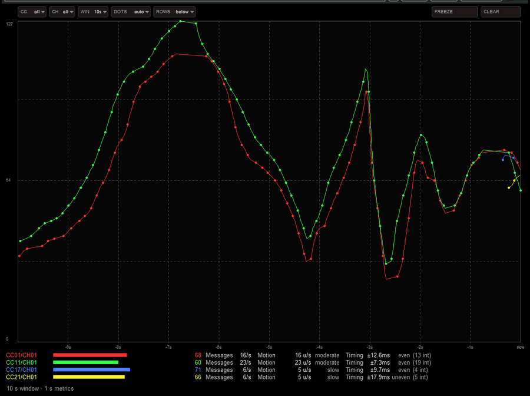
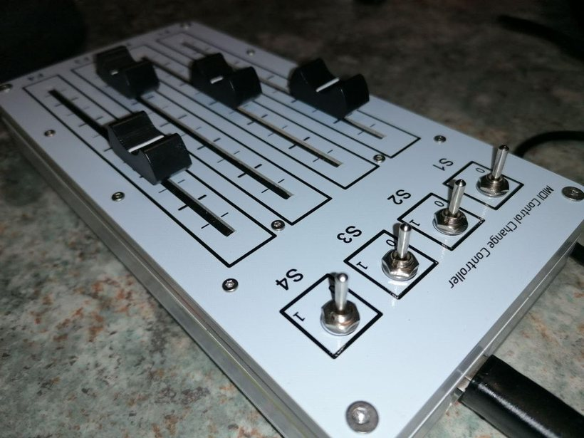

# CCScope — MIDI CC oscilloscope and fader bars

A JSFX effect for REAPER 6.37 or newer.

Recorded in REAPER: one fader gesture, four CC streams (four shades of colour), the
metrics updating live. The static screenshot used by ReaPack is [`ccscope.png`](ccscope.png).
Both were recorded on 0.6, when the parameters were REAPER sliders in a strip above the plot;
the same readings, with the controls now drawn by the plugin, are in the bar at the top.

Two display modes: a scrolling time graph and one fader bar per active CC. Each CC number is
tracked **per MIDI channel**, so the same CC from different channels is shown and measured
separately — same hue per CC, a different shade per channel, and the row label carries the
colour. The CC filter and the channel filter are independent and combine: one CC, one
channel, or one CC on one channel.

- **The control bar** — the seven parameters have no REAPER sliders: the sliders are declared
  with a leading `-` in their name, which hides them while keeping them automatable, saved in
  presets and listed by the FX window's **Param** button. In their place the plugin draws a bar
  of seven cells at the top of the canvas. Hiding the strip gives back **190 px** of window
  height (measured on REAPER 7.84), which is about eleven rows of pairs.
  - click a cell with a caret to open its list, **the wheel** steps the value, a **right click**
    restores the default;
  - `CC` (`all` or one controller), `CH` (`all` or one channel);
  - `WIN` — the time window, 1–30 s; the time axis is labelled from `-10s` to `now`;
  - `DOTS` — `auto` (one every 12 px), `every event`, `none`;
  - `ROWS` — `below` or `beside` (see below);
  - `FREEZE` — stops acquisition (MIDI still passes through) so a reading can be examined;
  - `CLEAR` — wipes history and metrics.

  In a narrow window the cell labels are dropped first, and `FREEZE`/`CLEAR` keep theirs; below
  ~460 px of width the last cells are clipped, and at that size the plot is not much of a plot
  either.
- The two filters (which CC, which channel) combine, so *CC1 on channel 3*, *every CC on
  channel 3* and *CC1 on every channel* are all selections; they share one list, and the graph
  and the bars read that list, so they cannot disagree about what is on screen.
- **Where the pair list lives** — **below** the plot (default) or **beside** it, as a column on
  the right. The column uses the whole window height and keeps the same 16 px per row, so one
  window shows more pairs than with the list below — measured at 1016×600: 10 pairs below, 18
  beside. Below ~720 px of window width the plot would be too narrow to be a plot, so the
  layout falls back to the rows below and the status line says
  `rows beside need a wider window`.

One row per (CC, channel) pair. With the list **below**, the rows take the height they need:
the plot keeps a minimum share of the window, so a taller window shows more pairs instead of
only a taller graph. With the list **beside**, the window height feeds the column and the plot
keeps the full height. In both cases, when rows still do not fit the status line says how
many are on screen and what to do about it.

Three numbers per row, named after what they mean rather than how they are computed. Pointing at
them explains them on screen:

| | what it says |
|---|---|
| **Messages** | how many times per second the controller sends — its update rate |
| **Motion** | how far the value (0–127) travels per second — how fast the gesture is; rated slow, moderate, brisk, fast |
| **Timing** | how much the spacing between messages wobbles, in ms — rated steady, even, uneven, loose, erratic, and shown with the number of intervals it was computed on. Gaps (a pause, a loop jump) are not counted as jitter, and `n/a` means there were too few intervals to say |

The window is exactly one second, filtered on read, so a rate of 240/s is what the plugin was
measuring and not what happened to be in a buffer.

It was written for testing MIDI hardware: the numbers tell you whether a controller really
transmits at high resolution, whether its timing is stable, and how hard you are actually moving it.

## The hardware it was written for

Four faders and four switches, each fader on its own CC (1, 11, 17, 21): the animation
above is this device. Photo and review are mine —
[Amazon.it](https://www.amazon.it/dp/B0FT2DSFHN).

It answers a question a MIDI logger does not: **how fast, and how regularly, does this
controller actually send?** That is `Messages/s` per CC and per channel, and it is what
makes the plugin useful beyond faders — to check a rate limit in a JSFX of your own, for
example.

## Discussion

Reports, questions and announcements happen in the REAPER forum thread, where the plugin
started: [CCScope — MIDI CC oscilloscope](https://forum.cockos.com/showpost.php?p=2972028&postcount=21).
Bugs and trackable requests are better as [issues](https://github.com/solyarisoftware/reaper/issues),
because a thread grows and forgets.

## Changelog and roadmap

- [CHANGELOG.md](CHANGELOG.md) — what changed, release by release
- [TODO.md](TODO.md) — what is missing: the issues, the forum requests, the ideas
