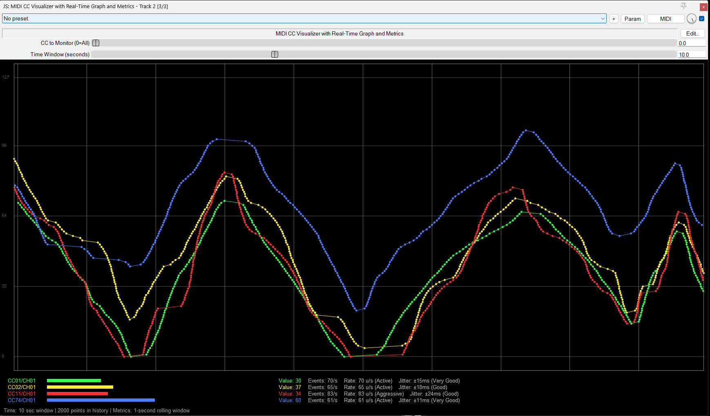

# REAPER tools

My public REAPER tools, published as a **ReaPack repository** — install once, and REAPER keeps
them up to date.

## Install

In REAPER: *Extensions → ReaPack → Import a repository*, paste this URL, then synchronize:

```
https://github.com/solyarisoftware/reaper/raw/master/index.xml
```

Manual install, if you prefer: copy the `.jsfx` **and** its `.jsfx-inc` companions into `Effects/MIDI/`
inside your REAPER resource directory (on Windows `%APPDATA%\REAPER\Effects\MIDI`).

## Packages

| Package | Type | Category | What it does |
|---|---|---|---|
| [MIDI CC Visualizer](MIDI/midi_cc_visualizer.jsfx) | JS effect | MIDI | Real-time graph and value bars of MIDI CC messages, per channel, with performance metrics |

### MIDI CC Visualizer



Two display modes: a scrolling time graph and one bar per active CC. Each CC number is tracked
**per MIDI channel**, so the same CC from different channels is shown and measured separately.

- **Slider 1** — CC to monitor (`0` = all CCs, `1-127` = one CC)
- **Slider 3** — time window, 1–30 s
- **Metrics**, computed over a 1 s rolling window: **events/s** (message frequency — controller
  resolution), **rate** in units/s (how fast the values move — gesture intensity), **jitter** in ms
  (timing consistency — a hardware quality indicator)

It was written for testing MIDI hardware: the numbers tell you whether a controller really
transmits at high resolution, whether its timing is stable, and how hard you are actually moving it.

## How this repository is organised

This is a ReaPack repository, so **the folder tree is the package taxonomy**: a file in `MIDI/`
is installed as `Effects/MIDI/<file>` and shows up under the *MIDI* category in ReaPack. The
`index.xml` at the root is generated from the files' metadata headers by
[reapack-index](https://github.com/cfillion/reapack-index) running in GitHub Actions — do not
edit it by hand.

## Related repositories

The scale collections are separate projects, each with its own documentation:

- [Claude-Debussy-Scales](https://github.com/solyarisoftware/Claude-Debussy-Scales)
- [Alexander-Scriabin-Scales](https://github.com/solyarisoftware/Alexander-Scriabin-Scales)
- [Olivier-Messiaen-Modes](https://github.com/solyarisoftware/Olivier-Messiaen-Modes)

## License

[MIT](LICENSE) — Copyright (c) 2025-2026 Giorgio Robino.
