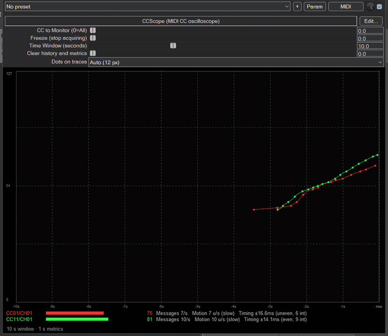
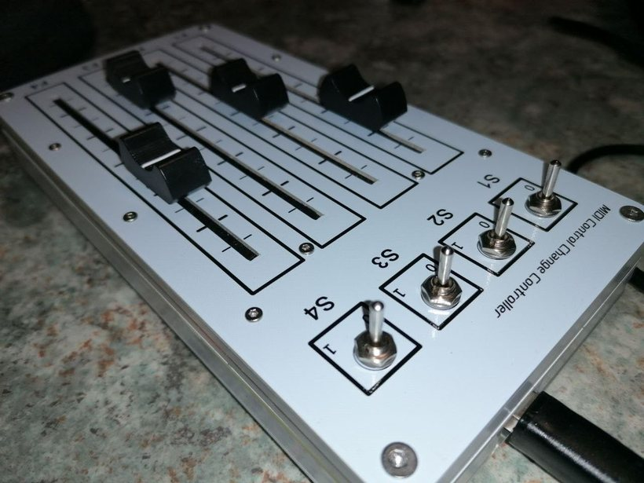

# REAPER tools

My public REAPER tools, published as a **ReaPack repository** — install once, and REAPER keeps
them up to date.

## Install

In REAPER: *Extensions → ReaPack → Import a repository*, paste this URL, then synchronize:

```
https://github.com/solyarisoftware/reaper/raw/master/index.xml
```

Manual install, if you prefer: copy the `.jsfx` **and** its `.jsfx-inc` companions into `Effects/MIDI/`
inside your REAPER resource directory (on Windows `%APPDATA%\REAPER\Effects\MIDI`).

## Packages

| Package | Type | Category | What it does |
|---|---|---|---|
| [CCScope](MIDI/ccscope.jsfx) | JS effect | MIDI | Oscilloscope for MIDI CC: scrolling graph and fader bars, per channel, with performance metrics |

### CCScope — MIDI CC oscilloscope and fader bars



Recorded in REAPER: one fader gesture, four CC streams (four shades of colour), the
metrics updating live. The static screenshot used by ReaPack is
[`ccscope.png`](MIDI/ccscope.png).

An oscilloscope for MIDI CC: two display modes, a scrolling time graph and one fader bar per active CC. Each CC number is tracked
**per MIDI channel**, so the same CC from different channels is shown and measured separately —
same hue per CC, a different shade per channel, and the row label carries the colour.

- **Slider 1** — CC to monitor (`0` = all CCs, `1-127` = one CC)
- **Slider 2** — Freeze: stops acquisition (MIDI still passes through) so a reading can be examined
- **Slider 3** — time window, 1–30 s; the time axis is labelled from `-10s` to `now`
- **Slider 4** — Clear history and metrics; it returns itself to `0`

Three numbers per row, named after what they mean rather than how they are computed. Pointing at
them explains them on screen:

| | what it says |
|---|---|
| **Messages** | how many times per second the controller sends — its update rate |
| **Motion** | how far the value (0–127) travels per second — how fast the gesture is; rated slow, moderate, brisk, fast |
| **Timing** | how much the spacing between messages wobbles, in ms — rated steady, even, uneven, loose, erratic, and shown with the number of intervals it was computed on. Gaps (a pause, a loop jump) are not counted as jitter, and `n/a` means there were too few intervals to say |

The window is exactly one second, filtered on read, so a rate of 240/s is what the plugin was
measuring and not what happened to be in a buffer.

It was written for testing MIDI hardware: the numbers tell you whether a controller really
transmits at high resolution, whether its timing is stable, and how hard you are actually moving it.

### The hardware it was written for



Four faders and four switches, each fader on its own CC (1, 11, 17, 21): the animation
above is this device. Photo and review are mine —
[Amazon.it](https://www.amazon.it/dp/B0FT2DSFHN).

It answers a question a MIDI logger does not: **how fast, and how regularly, does this
controller actually send?** That is `Messages/s` per CC and per channel, and it is what
makes the plugin useful beyond faders — to check a rate limit in a JSFX of your own, for
example.

## How this repository is organised

This is a ReaPack repository, so **the folder tree is the package taxonomy**: a file in `MIDI/`
is installed as `Effects/MIDI/<file>` and shows up under the *MIDI* category in ReaPack. The
`index.xml` at the root is generated from the files' metadata headers by
[reapack-index](https://github.com/cfillion/reapack-index) running in GitHub Actions — do not
edit it by hand.

## Changelog and roadmap

- [CHANGELOG.md](CHANGELOG.md) — what changed, release by release
- [TODO.md](TODO.md) — what is missing: the issues, the forum requests, the ideas

## Related repositories

The scale collections are separate projects, each with its own documentation:

- [Claude-Debussy-Scales](https://github.com/solyarisoftware/Claude-Debussy-Scales)
- [Alexander-Scriabin-Scales](https://github.com/solyarisoftware/Alexander-Scriabin-Scales)
- [Olivier-Messiaen-Modes](https://github.com/solyarisoftware/Olivier-Messiaen-Modes)

## License

[MIT](LICENSE) — Copyright (c) 2025-2026 Giorgio Robino.
