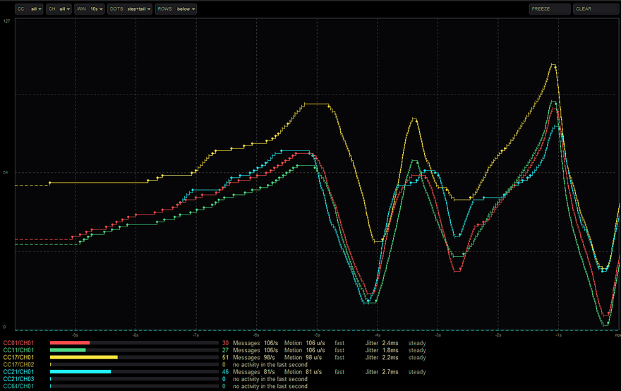
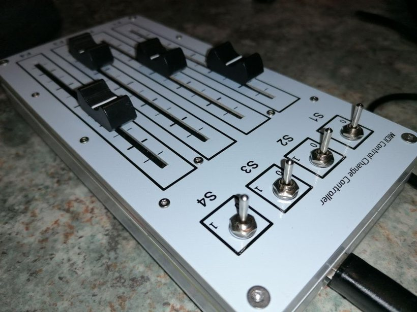

# CCScope — MIDI CC oscilloscope and fader tester

A JSFX for REAPER 6.37 or newer. It shows what a MIDI controller actually sends: the shape of
the movement over time, one fader bar per active CC, and how fast and how regularly each CC
transmits — on each MIDI channel separately.

Recorded in REAPER with **CC 1 and CC 11 on channel 1**: one colour per CC, the graph and the
fader bars updating live, the three metric columns changing with the movement, and the hover
panels explaining a reading. The static screenshot used by ReaPack is
[`ccscope.png`](ccscope.png).

## What it does

- **Two display modes**: a scrolling time graph (1–30 s window, labelled axis) and one fader bar
  per active CC with its current value.
- **A literal graph**: a mark is an event the controller sent, and the line between two marks is
  the value held in between — a step, never a diagonal through values that were never sent. After
  the last event the held value continues dashed, because there the drawing is an inference. A
  dense stream swaps the circle for a short tick instead of dropping events: only the step is
  decimated, and the status line says by how much.
- **Per (CC, channel)**: the same CC number on different channels is shown and measured as its
  own row — same hue per CC, a different shade per channel. The CC filter and the channel filter
  are independent and combine: one CC, one channel, or one CC on one channel.
- **Three measurements per row**, over exactly the last second: **Messages**, **Motion**,
  **Jitter**. Resting on a visible metric explains its reading on screen.
- **Rows below or beside the plot**, so a window that is wide and short can still show every
  pair. In a narrow window the labels go first and the status line says what does not fit.
- **FREEZE** stops acquisition (MIDI keeps passing through) so a reading can be examined;
  **CLEAR** wipes history and metrics.
- **A status line under everything** says what the plugin is observing — `Waiting`,
  `Receiving`, `Idle` or `Frozen` — with the streams, channels and messages per second of the
  current selection, and the warnings when rows or the beside layout do not fit. The state word
  brightens while messages are arriving and dims when nothing has ever come. The package version
  sits at the right edge.
- **A control bar instead of REAPER's sliders** — `CC`, `CH`, `WIN`, `DOTS`, `ROWS`, `COLOR`, `FREEZE`,
  `CLEAR` at the top of the canvas. Click a cell to open its list, the wheel steps the value, a
  right click restores the default. The parameters stay automatable, saved in presets and listed
  under **Param**.

### Color palette

**COLOR** selects one of six palettes: Default - Daybreak (the default), Default - Twilight,
High contrast - Signal, High contrast - Neon, Color-blind aware - Spectrum, and
Color-blind aware - Muted. The compact cell shows their numbers 1–6 in that order; the list
marks the active choice. The setting is a parameter, saved with presets and available to
automation. The same CC always uses the same slot regardless of arrival order: CC 1 uses slot
0, CC 17 uses slot 0, and CC 0 uses slot 15. Colors repeat every 16 CCs; channel shading
remains in use. The color-blind-aware palettes are not a guarantee of accessibility.

### The status line

One line under the canvas, in four states:

| state | when | what it means |
|---|---|---|
| `Waiting` | no pair of the selection holds any data | nothing has been received yet, or `CLEAR` wiped it |
| `Receiving` | at least one pair has a message in the rolling last second | the selection is speaking |
| `Idle` | pairs hold data, none in the last second | it spoke, then went quiet |
| `Frozen` | `FREEZE` is engaged | acquisition is paused; what you see is not a current observation |

The state word brightens as it goes from `Waiting` to `Receiving` and turns amber on `Frozen`, so
the answer to "is anything coming?" is visible before the wording is read. Colour never carries a
state on its own; the word always says it too.

Two numbers follow: **streams** (pairs with a message in the last second), **channels** (distinct
channels among them) and **msg/s** (their total). All three describe the **selection**, so with a
CC filter or a channel filter they describe the filtered set, not everything arriving at the
track. They are computed every 100 ms, never per rendered frame.

When the window cannot hold everything, fields are dropped in a fixed order: first the version at
the right edge, then the note after the state, then the channel count, then the stream count. The
two warnings — `showing N of M pairs` and `rows beside need a wider window` — are never dropped.
`CLEAR` returns the state to `Waiting`, because nothing has been received since.

Two limits worth knowing: the per-pair metrics buffer holds 500 events in the one-second window,
so a pair transmitting faster than that saturates at 500 msg/s and the aggregate sums those
saturated values; and a selection larger than the rows on screen is exactly what the
`showing N of M` warning is for.

### What the numbers mean

| | what it says |
|---|---|
| **Messages** | received MIDI CC messages in the last second, including repeated identical values — not distinct values or physical movements |
| **Motion** | sum of absolute CC value changes associated with messages in the last second, in CC units/s; rated slow, moderate, brisk, fast. This is MIDI value travel, not physical fader speed; intentional movement, noise and jumps can all contribute |
| **Jitter** | **Message timing jitter:** population standard deviation of accepted inter-message intervals, in ms; rated steady, even, uneven, loose, erratic. The hover panel shows the accepted interval count for valid readings. Intervals **greater than four times** the shortest interval in the window are excluded by a gap heuristic; `n/a` means fewer than four usable intervals (normally at least five messages are needed) |

All three use the rolling **last second**, independently of the plot's **WIN**. **FREEZE**
keeps the same instant for the rows and their help, not a new wall-clock reading.

- **Messages** has no quality scale. Ten identical messages count as ten, but add no Motion.
  More messages do not establish finer value resolution or better hardware.
- **Motion** measures travel in 7-bit CC units (values 0–127), not percent. For example,
  60 → 65 → 70 → 75 contributes 15 units; 60 → 70 → 60 contributes 20, despite ending
  where it started. The first-ever message contributes zero; later deltas can refer to a
  previous message outside the one-second window. `0 u/s` means no measured value travel,
  not necessarily a motionless physical fader.
- **Jitter** is spread in message spacing, not the average spacing. Five equally spaced
  messages provide four intervals and `0.0 ms`: no variation in those accepted intervals,
  not proof of perfect timing. `n/a` is insufficient evidence, not zero jitter. The gap
  heuristic can remove intentional pauses as well as gaps; it is not a device diagnosis.
  For devices that send only when values change, spacing can also vary with the gesture.
  CCScope observes the received stream, not the isolated timing contribution of the device,
  transport or host. Its absolute millisecond scale is not normalized to the average interval.

The descriptive scales (not grades) are:

| Motion (displayed integer, CC units/s) | Meaning | Jitter (unrounded ms) | Meaning |
|---|---|---|---|
| **slow** ≤15 | little value travel | **steady** ≤5 | very little spacing variation |
| **moderate** >15 to 40 | moderate value travel | **even** >5 to 15 | small spacing variation |
| **brisk** >40 to 70 | brisk value travel | **uneven** >15 to 30 | noticeable spacing variation |
| **fast** >70 | rapid value travel | **loose** >30 to 50 | large spacing variation |
| | | **erratic** >50 | very large spacing variation |

Jitter is displayed to one decimal but classified before rounding: a reading just above
5 ms can display `5.0 ms (even)`. Standard deviation is **not a guaranteed ± bound**, a latency
measurement or a hardware-quality grade. These are observations of MIDI output, not physical
calibration. Motion cannot distinguish intentional gestures from noise or jumps. No incoming
messages do not establish that a stationary fader is noise-free: some devices send only when
a value changes.

Labels, values with their units and descriptive words are all **left-aligned** at fixed
positions, in both layouts and compact tiers. Changing the number of digits never moves
another field; each pair still occupies one row.

### Row identity and value

Hover **CCnn/CHnn** for stream identity: `CC00/CH01` means controller number 0 on MIDI
channel 1. CC numbers range from 0 to 127; channels from 1 to 16. Leading zeroes are only
formatting. Label, bar and value share a CC base color with a channel shade; colors and
shades can repeat, so the text identifies the pair. None of these identifies a physical device.

Hover the **colored number or its bar** for the same stored-value explanation. It is a
7-bit MIDI value, 0–127, not percent or physical fader position. Idle and Freeze retain the
stored value; Clear resets it to zero without confirming that the device sent zero. Even
at zero the bar keeps a small visible stub. These targets remain available when the metric
fields report no activity or only show Messages.

### Reading hover help

Help uses **16 px text**, an **18 px title** and an **opaque black background**, wrapping
within a panel up to 520 logical pixels wide. A compact live-reading section is followed by
**Description:** and the general explanation; only the space needed by its possible states
is reserved, rather than a fixed block of empty lines.

Rest on a row identity, colored value/bar or metric cell for about **400 ms**. Moving to a
different pair or subject restarts the wait; leaving the target dismisses help immediately.
The number and its bar share one subject and a stable anchor; the gap between them is not a target. Each panel is anchored to its cell, not the
moving pointer, and shows its current reading, definition/unit and descriptive scale. The
count-only layout exposes **Messages** only. The consolidated **no activity** sentence is also
a Messages target: it explains zero messages without inventing Motion or Jitter readings.
`n/a` has its own insufficient-data explanation. Gaps and blank right-hand space are not targets;
the small valid-reading interval annotation belongs to Jitter. **`int` means accepted
inter-message intervals**: `(15 int)` means 15 intervals used by the calculation, not 15
messages. The abbreviation is expanded in both full and compact help. Open control-bar lists
suppress help.

Help wraps and stays inside the canvas, choosing above or below the cell according to space.
Its geometry stays fixed per metric at a fixed viewport as values and categories change.
If the full explanation cannot fit, a compact definition/current meaning points back to this
README instead of showing the complete legend. If even that cannot fit (including canvases
narrower than 252 logical pixels), no panel is drawn.

## The hardware it was written for

Four faders and four switches, each fader on its own CC (1, 11, 17, 21) — the device this plugin
was written for. Photo and review are mine —
[Amazon.it](https://www.amazon.it/dp/B0FT2DSFHN).

It answers a question a MIDI logger does not: **how fast, and how regularly, does this
controller actually send?** That is `Messages` per CC and per channel, and it is what makes the
plugin useful beyond faders — to check a rate limit in a JSFX of your own, for example.

## Install

Via ReaPack: *Extensions → ReaPack → Import a repository*, paste
`https://github.com/solyarisoftware/reaper/raw/master/index.xml`, then synchronize. The package
is in the `ccscope` category. Install it from ReaPack rather than copying `ccscope.jsfx`
alone: the plugin is one conductor plus its `.jsfx-inc` companions, and a missing include is a
plugin that will not load.

## Feedback, roadmap and history

- **Bugs and defined changes** — [issues](https://github.com/solyarisoftware/reaper/issues):
  a bug report with reproduction steps, or an `enhancement` issue with completion criteria.
- **Ideas and design questions** — [Discussions › Ideas](https://github.com/solyarisoftware/reaper/discussions/categories/ideas).
  That is where the roadmap is: what is being considered, what was decided and why. How to
  report is in [Discussion #16](https://github.com/solyarisoftware/reaper/discussions/16), the
  full guidelines in [CONTRIBUTING.md](../../CONTRIBUTING.md).
- **Forum** — the plugin started in the REAPER forum thread
  [CCScope — MIDI CC oscilloscope](https://forum.cockos.com/showthread.php?t=304766), announced
  at 0.7.4 in [post #21](https://forum.cockos.com/showpost.php?p=2972028&postcount=21).
- **History** — [CHANGELOG.md](CHANGELOG.md), one line per notable change.
- **Proposal, not implemented** —
  [Device testing](docs/device-testing.md): possible Hold/Sweep sessions for hardware
  evaluation, discussed in [Discussion #11](https://github.com/solyarisoftware/reaper/discussions/11).
